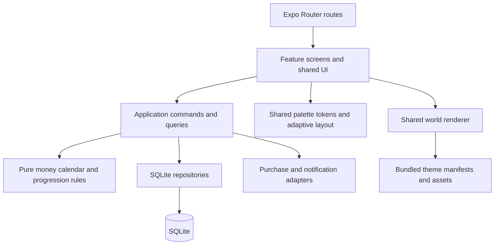

# Technical architecture

Build a single offline iPhone application with small feature modules. SQLite owns financial records under [MVP v1.2](Saving_Worlds_MVP_Plan_v1_2.docx). Pure TypeScript owns calculations. Screens consume application commands and queries. World themes supply assets to one renderer. This keeps the core savings experience testable without adding a server or a general game framework.

Read [requirements](PRODUCT_REQUIREMENTS.md), [data model](DATA_MODEL.md), [tech stack](TECH_STACK.md), [asset specification](ASSET_SPEC.md), [design system](DESIGN_SYSTEM.md), [adaptive layout](ADAPTIVE_LAYOUT.md), [EAS delivery](EAS_AND_OTA.md) and [decisions](DECISIONS.md) together. This is a design, not an implemented architecture.

## Boundaries and dependency direction



- Domain modules import no React, SQLite or native APIs. They accept clocks, policy values and inputs explicitly.
- Application commands validate input/capabilities, run atomic repository operations and invalidate affected query snapshots after commit. Queries return typed view models. Use explicit functions and constructors, not a dependency injection container or global event bus.
- Database access stays in data adapters; feature screens never execute SQL. A repository interface is justified at the SQLite/native boundary, not for every helper.
- Expo Router files compose screens and validate route IDs. They contain no business decisions. Features may use another feature's small public API, never its private store or SQL tables directly.
- Zustand holds selected goal ID, load/error state, query snapshots and session UI preferences. Durable preferences are loaded from SQLite. No persisted balance or separate JSON goal store.

## Planned code layout

All paths below are future implementation targets unless noted. Actual documentation links resolve now; future code paths are not broken documentation links.

Phase 01 created the shell that exists today: `src/app/_layout.tsx` (root Stack and root-level native form sheets), `src/app/(tabs)/_layout.tsx` (NativeTabs), one native Stack per tab in `src/app/(tabs)/(home)/`, `(challenges)/` and `(collection)/` with Settings and a temporary detail route in the Home stack, `src/bootstrap/` (redacted build/update diagnostics). Phase 02 added `src/shared/theme/` (private palette, semantic tokens, native navigation appearance), `src/shared/ui/` (AppText, Button, TextField, Card, AmountText, Notice and the temporary PlaceholderScreen) and the development-only gallery (`src/dev/` behind the guarded Home-stack route `dev-gallery`); see [DESIGN_SYSTEM](DESIGN_SYSTEM.md). Phase 03 added `src/shared/layout/` (Screen, FormScreen, ContentColumn, AdaptiveGoalLayout, the ArrangementView adapter and inset policy) and replaced PlaceholderScreen with it; the development-only layout lab (`/dev-layout`) and sample form sheet (`/sample-form`) live in `src/dev/`; see [ADAPTIVE_LAYOUT](ADAPTIVE_LAYOUT.md#implementation-phase-03). Phase 04 added the pure domain in `src/core/`: `money/` (minor units, ISO 4217 registry, strict parsing, exact formatting), `calendar/` (civil dates, `Clock` boundary, deadline pace), `progression/` (shared stage function, theme IDs) and `access/` (capability contract, Free default), with lint rules that keep it free of React/native/database imports and real-time reads (DECISIONS D50-D51). Phase 05 added `src/data/db/` (SqlDriver boundary, expo-sqlite adapter, `AppDatabase` with one serialized exclusive write connection and a query-only read connection, migration runner, schema 1), `src/data/repositories/` (goal, ledger, receipt, settings adapters with row validation), `src/data/command.ts`, `src/features/ledger/` (chronological candidate-history rule, create/correct/delete commands, ledger query), `src/features/goals/application/` (createGoal, goal summaries), `src/core/text/` and the startup gate in `src/bootstrap/` (DatabaseGate, readiness store, storage failure screen); see DECISIONS D52-D55. Phase 06 added goal edit/lifecycle commands and the pure lifecycle table (`src/features/goals/domain/`, `application/goal-commands.ts`, `goal-selection.ts`, `goal-queries.ts`), the global currency command and queries (`src/features/settings/`), goal/onboarding/Home/Collection/Settings presentation (`src/features/*/presentation/`), the committed-data snapshot and command dependencies (`src/bootstrap/app-data.ts`), locale and date-picker helpers (`src/shared/i18n/`), the shared toast and SF Symbols wrappers (`src/shared/ui/toast.tsx`, `icon.tsx`) and the routes `/onboarding` and `/goal-form`; see DECISIONS D56-D58. Phase 07 added the ledger presentation (`src/features/ledger/presentation/`: the shared Add/Edit Entry form, entry draft parsing, kind and date fields, History and error copy) on the unchanged Phase 05 ledger commands, `readEntryContext` in the ledger queries, the routes `/entry-form` (root form sheet) and `/history` (Home stack), `useCommittedRead` and `ledgerCommandDeps` in `src/bootstrap/app-data.ts`, shared amount-error copy (`src/shared/i18n/amount-messages.ts`) and the haptics wrapper (`src/shared/ui/haptics.ts`); see DECISIONS D61-D62. Phase 07.5 added the visual-direction primitives in `src/shared/ui/` (`progress-bar.tsx`, `list-row.tsx`, `section-header.tsx`, `status-badge.tsx`, `empty-state.tsx`, `header-button.tsx`), the honey accent tokens, the development-only Home direction mocks (`src/dev/home-directions.tsx`, `placeholder-scene.tsx`, guarded route `/dev-home`) and moved Settings to Home's navigation bar; see DECISIONS D64-D65. Phase 08 added the Home dashboard view model (`src/features/goals/presentation/home-dashboard.ts`) and pace copy (`src/shared/i18n/deadline-messages.ts`) over the Phase 04 `deadlineEstimate`, the temporary world region `src/features/worlds/world-scene.tsx`, `today` and an injectable app clock in the committed snapshot, foreground civil-date reconciliation (`src/bootstrap/foreground.ts`), the deadline card, Home's native ⋯ goal menu and the shared floating "+ Add savings" button (`floatingAction` slot of `Screen`/`AdaptiveGoalLayout`, used by Home and History); see DECISIONS D70-D73. Phase 09 added the theme manifest contract, export adapter, registry and the layered renderer in `src/features/worlds/` (`manifest.ts`, `theme-export.ts`, `registry.ts`, `themes/island-assets.ts`, `world-scene.tsx` with its scene-only fallback), the bundled Island art in `assets/themes/island/` (unchanged D76 export, 1536 size), stage names in Home's callout, the stage-0 Island in Home's empty state, `expo-image` and the development-only World inspector (`src/dev/world-inspector.tsx`, guarded route `/dev-world`); see DECISIONS D77. Phase 11 added schema 3 `collectibles` and its repository, the souvenir award inside the ledger and target-edit transactions (`src/features/collection/application/souvenir-award.ts`), `CURRENT_THEME_VERSIONS` and `themeManifestAt` for historical art, the souvenir moment in the world motion, Finish in Home's ⋯ menu, and the Collection feature (`src/features/collection/presentation/`: list and the `/souvenir?goalId=` detail with Reopen and Delete; `closed-goals.tsx` removed); see DECISIONS D95-D96. Phase 12 added schema 4 `challenge_attempts` and its repository (`src/data/repositories/challenge-attempt-repository.ts`), calendar weeks and the start instant of a civil date in a zone (`src/core/calendar/week.ts`), the pure fixed-challenge rules and board view (`src/features/challenges/domain/challenge-rules.ts`), the start/skip/close-ended commands and the in-transaction reconciliation called by the ledger commands (`application/challenge-commands.ts`), the board query (`application/challenge-queries.ts`), attempt deletion inside `deleteGoal`, and the foreground close of ended weeks (`closeEndedChallengeAttempts` in `src/bootstrap/app-data.ts`); see DECISIONS D103. Tests live in `tests/unit/`, `tests/integration/` and `tests/native/` (scenarios run on iOS by `npm run test:db` and on host SQLite in Jest).

```text
src/app/                         route adapters and navigation layouts
src/bootstrap/                   composition, migrations, startup and foreground reconciliation
src/core/money/                  minor units, currency metadata, parsing and formatting
src/core/calendar/               civil dates, clock boundary, cadence calculations
src/core/progression/            shared milestone and transition rules
src/core/access/                 capability contracts and Free baseline
src/data/db/                     connection, versioned migrations, write serialization
src/data/repositories/           SQLite goal, ledger, completion and challenge adapters
src/features/goals/              domain, application, presentation
src/features/ledger/             commands, history and correction UI
src/features/worlds/             manifests, shared renderer (Phase 09), transition planner and motion coordinator (Phase 10), ambient switches and driver (Phase 10.5)
src/features/collection/         souvenir and completed-goal views (Reopen, Delete)
src/features/challenges/         three fixed rules, attempts, calculated progress and UI
src/features/reminders/          persisted preferences and OS scheduling adapter
src/features/billing/            native adapter, entitlement reconciliation and capability queries
src/features/statistics/         global-currency totals, 30-day series and Pro UI
src/features/settings/           local preferences and privacy/data screens
src/shared/theme/                palette, typed semantic tokens and native appearance (exists)
src/shared/ui/                   accessible native controls (exists)
src/dev/                         development-only tools such as the component gallery (exists)
src/shared/layout/               screen/inset policy, measured regions and adaptive adapter (exists)
src/shared/i18n/                 English strings and formatting helpers
assets/themes/island/            approved local layered exports (exists, Phase 09)
assets/themes/garden/            approved local layered exports
tests/unit/                      deterministic financial and schedule rules
tests/integration/               command/repository behavior
tests/native/                    actual Expo SQLite/native adapter scenarios
maestro/                         critical device user journeys
```

Avoid empty layer folders for trivial modules. Start with the necessary files; split when there is more than one real concern. A monorepo, ORM, remote cache, plugin loader and analytics platform are unnecessary here.

## Early styling and adaptive foundation

The first three implementation phases establish the latest stable Expo project/package set, the app palette/shared StyleSheet system, then native responsive/Duo layout. They precede financial feature UI. Reuse shared theme/ui/layout modules in every later phase; do not recreate per-feature scaling or palette logic.

Native Stack and NativeTabs own navigation chrome. A small layout adapter composes scene and financial controls through the supported native adaptive container, with an explicit older-OS fallback. Live window measurements and local onLayout bounds size content; they never enter financial domain modules, SQLite or a persisted UI store. Four-edge inset ownership, keyboard/short-window behavior and draft preservation are defined in ADAPTIVE_LAYOUT.

Worlds render into their measured region, not physical screen dimensions. Palette changes do not change a goal's scene theme or paid rights. A resize/fold can update presentation only: it cannot create a transaction, change a target, reset a draft or award completion. All native integration facts require actual locked-build/device verification.

## Startup and offline behavior

1. Open one managed database connection, configure integrity settings, and migrate before reading feature data. Serialize writes. Block mutation UI while migrations run.
2. Read settings, selected goal and goal summaries. Invalid or unavailable selected IDs fall back deterministically to an available goal or the empty Home state.
3. Render local state without waiting for store connectivity. Load world assets locally. Reconcile native entitlements and reminders as independent work.
4. On foreground, re-read the civil date/time zone, close expired fixed challenge attempts and recalculate results and estimates, reconcile notification intent and query StoreKit state. A failed native call does not erase local data or previously verified rights.
5. If a migration/storage read fails, show a retryable recovery state. Never reset the database automatically. Capture a redacted error code for support.

Purchase/restore, OTA download checks and external support/privacy links may use networking. OTA availability never gates opening the local ledger or rendering the embedded/cached app. No networking dependency belongs in deposit, withdrawal, history, progression, basic challenges or already unlocked world rendering.

## EAS build and update boundary

EAS Build produces the native binaries; EAS Update supplies compatible JS/assets through expo-updates. These delivery services receive no savings payload from application commands. The app has no in-app Expo account or custom backend. Configuration begins in Phase 01; focused release-mode delivery/recovery acceptance is Phase 20.

Use appVersion runtime policy with explicit native/persistence compatibility checks. A shared-runtime OTA must preserve SQLite schema and persisted data meaning for the candidate, known-good and embedded fallbacks. New native APIs/config or incompatible data changes require a new app version/runtime/native binary. A build-number bump alone does not make them compatible. Keep the profile/channel/environment contract in EAS_AND_OTA authoritative.

Update checks run without blocking local startup and a fetched update activates at a later normal launch. Never force reload a draft, write/migration or store transaction. A rollback changes executable code, not ledger data; preserve records and verify the previous reader before any rollback. Keep working embedded/cached assets, including both release themes, available offline. Audit EAS update metadata in privacy preparation rather than asserting no network traffic.

## Financial mutation flow

A submitted shared Home/Challenges transaction form retains one operation ID for retries. The command validates the global AppSettings currency, positive amount/kind, nonfuture civil date, open goal status and capability. In an exclusive serialized write transaction, recheck the current row revision and candidate goal history ordered by entry_date, createdAt, id. Every subtotal and final balance must stay nonnegative. Apply the current entry edit or confirmed deletion without retaining previous entry versions. No correction audit or independent challenge-created deposit.

In the same commit, recalculate eligible challenge results and insert the unique permanent collectible if the saved mutation or target edit first qualifies at >=100%. Receipt results support retry without a financial journal. All effects commit or roll back together. Goal/Settings commands enforce the one global currency lock and explicit lifecycle from DATA_MODEL. Finish/Reopen are explicit commands; completed is read-only until Reopen (no archived status, D74). paused remains editable without resuming reminder eligibility. Confirmed whole-goal deletion (D74) is one exclusive command with operation ID, revision check and identifiers-only receipt that removes the goal's entries, souvenir and challenge attempts with the goal; it cannot be undone.

After commit, invalidate affected goal/home/history/challenge/statistics queries. Return old/new balance/stage and a mutation revision for presentation. Animations never write financial state; notification/animation failure cannot duplicate or undo a committed operation. Restart derives the current scene from saved history without replaying a fake deposit.

## World and collection design

The pure engine returns milestone 0-10 from the current net amount and target. See exact arithmetic in DATA_MODEL. The renderer receives theme ID/version, milestone, fractional progress for minor feedback, motion preference and an optional committed transition. The same engine and renderer serve Island and Garden.

A static typed manifest declares a 0% base and ten threshold definitions with stable layer IDs, placement, z-order, reveal/hide/replacement sets, accessible scene description and static asset references. The 80% Island replacement hides the small house and reveals the larger house; do not simply accumulate every layer forever. No dynamic file-path require or remote asset download.

A multi-threshold deposit settles on the correct final scene, with one bounded reveal sequence. Decreases remove/reverse the affected layers with a quiet transition. Target edits can change stage; switching theme keeps stage. Rapid commits cancel/coalesce older animations by revision. Offscreen scenes stop ambient work. Reduced Motion updates immediately with a short accessible status message. Implemented in Phase 10 (D85): `world-transition.ts` is the pure planner and state machine (the revision is the app-data snapshot version), `use-world-motion.ts` runs its timeline on Home only while Home is focused and the app is active, and `WorldScene` animates layers from the manifest anchors (`reveal`, `upcomingStage`). Phase 10.5 (D91): ambient marks in the manifest (clouds, water sparkle, tree sway), `WorldScene ambient` driven by `useAmbientMotion()` on Home only, an inner ambient view per marked layer composed inside its reveal box, and the release switches in `ambient.ts`; no other scene (empty state, inspector sheet, Collection) moves on its own; since D100 a Collection card floats its still world as a whole (`AmbientFloat`), which is not scene ambient motion.

A collectible stores the theme/version at the first saved >=100% mutation, uniquely per goal including Free. Optional immutable title/target captions describe that moment; currency remains global. It persists even if the first entry was a mistake. A live 60% world and its permanent finished souvenir are both valid. No correction, withdrawal, theme/target change, Finish or Reopen removes/replaces it; only deleting its goal does (D74). Reaching 100% does not close the goal: explicit Finish sets completed, and Reopen sets active while within the Free limit without auto-Finish. Completed goals are read-only. Collection also lists completed goals honestly, with Reopen and Delete, keeping souvenir and current status distinct. Free keeps its one finished world. Implemented in Phase 11 (D95-D96): the Collection draws each souvenir with `themeManifestAt(themeId, themeVersion)` at stage 10, still, and its detail separates "Souvenir" (then) from "Goal now".

MVP achievement feedback consists of milestone reveals, completed-world souvenirs and calculated fixed challenge results. There is no separate badge/XP/level schema or general rewards engine.

## Challenges

Free and Pro share exactly First step, Next milestone and Weekly step. Persist attempts with frozen targets, start timestamps/dates and saved week/timezone boundaries as specified in DATA_MODEL and v1.2 section 7. At most one unfinished attempt per goal; First step once per goal and Weekly step at most once per goal/calendar week. No custom definitions, editable amounts/frequency, separate challenge pause, notification schedule or rewards economy.

Derive results from eligible saved ledger records, including eligible Home entries. Challenge Add savings opens the same form/command as Home; the challenge engine never creates or duplicates a transaction and does not require a separate evidence-link/confirmation action. Net eligible deposits minus withdrawals determine money-target progress; First step checks for a positive deposit. Edits/deletions recalculate both current and historical results. New records created after an ended week cannot retroactively complete it.

Completed/Not completed/Skipped are historical attempts. Corrections may change a historical Completed/Not completed result but never reactivate the attempt, take the active slot or repeat a notification. Skip retains history without punishment; use another available fixed type for a new attempt. Goal target/deadline changes never rewrite a started attempt's frozen contract.

Implemented in Phase 12 (D103): `challenge-rules.ts` decides eligibility, progress, settlement, availability (with the reason a rule cannot start), the frozen start contract and the `ChallengeBoard` view (current attempt, the three offers with previews, history newest first). `startChallenge`/`skipChallenge` run on the serialized write path with operation IDs and receipts; `reconcileGoalAttempts` runs inside `createEntry`/`correctEntry`/`deleteEntry` after the souvenir award, so an entry change and its challenge results commit or roll back together, and `LedgerMutationResult.completedAttemptId` names an attempt only when that commit completed it. `readChallengeBoard(db, goalId, clock)` settles for the current instant, so an ended week reads as history before `closeEndedAttempts` (foreground) writes it. Phase 13 presents the board and reuses the shared entry form; it recomputes no rule. Implemented in Phase 13 (D104): `src/features/challenges/presentation/` (`challenges-screen.tsx`, `quest-cards.tsx`, `challenge-copy.ts`, `completed-quest.ts`); the entry route takes `from=challenges`, and the form notes `completedAttemptId` so the Challenges tab celebrates it once in its card.

## Purchases and capabilities

A PurchaseGateway hides native package APIs. It supplies product metadata, verified current entitlements, transaction updates, purchase initiation, explicit restore and finishing/acknowledgment. Phase 15 must prove actual StoreKit verification, completed non-consumable handling, duplicate delivery, pending outcomes, cold-start recovery and revocation for the pinned library. A purchase event or a decoded JWS string alone is not verification.

Map the single Pro product to unlimited goals, Garden, open-goal Island/Garden switching and the four Pro statistics. Challenges are identical in Free and Pro. Keep independently addressable theme capability keys for later products; do not sell or assign future theme rights now. SQLite stores an entitlement snapshot for responsiveness, never an authoritative editable Boolean. Reconcile with StoreKit at launch, foreground and transaction updates. An offline/network failure is unknown, not verified revocation. No app login, subscription, RevenueCat service or IAPKit service is introduced by default.

A completed store response is processed durably and idempotently before transaction finishing. Restore is available on the paywall and Settings. Explicit store sync may prompt for Apple credentials; ordinary startup only queries current state. Rights restoration never restores a deleted savings database. Confirmed loss (verified revocation/refund, Family Sharing removed) deletes or changes nothing (D74). With several goals the person chooses one goal to keep using; the others stay visible but read-only until Pro returns or they are deleted. A Garden goal keeps its world but cannot progress further in Garden without Pro; to continue saving the person switches it to Island (ledger, target and souvenir kept). Garden souvenirs remain. Temporary network failure alone retains prior verified rights.

## Deadline and statistics queries

Deadline estimates are Free and use the inclusive-day formulas in DATA_MODEL: weekly=min(R,ceil(R*7/D)), monthly=min(R,ceil(R*30/D)). No contribution-opportunity calendar. Handle absent/today/expired deadlines and R=0 without division by zero or punitive language.

Pro has exactly four views on one screen: current all-goal total; current-calendar-month deposit/withdrawal totals; total daily balance for the last 30 calendar days including opening balance from earlier records; count goals with status completed. Use one global currency. Include the ledger values of all existing goals (active, paused, completed); a deleted goal's entries are gone (D74). Never add souvenir snapshots. The line is all-goal, not selected-goal. Backdated corrections update chart/monthly summaries; provide accessible text. Q06 is resolved by v1.2.

## Reminders, recovery and security

Notification preferences are durable intent. Reconcile OS IDs on launch/foreground and after changes; schedule a bounded set and cancel orphaned requests. Use exactly one optional global Sunday 18:00 device-local weekly reminder, with generic privacy-preserving text. Schedule only while at least one active goal exists; paused/completed never trigger it. Settings has one switch, no goal/challenge cadence or time controls. Editing a paused goal does not resume reminders. No push registration, APNs service or assumption that JavaScript runs while terminated. OS delivery is best effort.

Use iOS sandbox protection, minimal permissions, parameterized SQL and redacted diagnostics. No API secret, receipt-signing key or financial notes in logs. Validate native file availability in the locked-device/background scenarios actually used. No SQLCipher/key-management system without a requirement.

Manual export/import is deferred. A future export should use a consistent logical schema-versioned snapshot of a read transaction, excluding authoritative purchase rights and device notification IDs. Future import validates into a temporary database, verifies invariants and uses a recoverable replacement process. Never copy only an open WAL database file. In MVP, OS device backup may include app data depending on user/system settings; it is not app cloud sync and cannot be promised. Test and document the chosen OS behavior rather than advertising a guarantee.

## Error handling and quality

Typed command failures distinguish validation, unavailable paid capability, stale edit, storage failure and native-service failure. Present specific recovery steps and preserve form input. Put a React error boundary around the app shell and retryable scene fallbacks around asset loading. A missing asset must not hide the ledger.

Every phase adds suitable domain, native or interaction verification. Actual SQLite, StoreKit sandbox/TestFlight, local notifications, VoiceOver and device performance need their own evidence; Jest mocks do not prove them. See [TEST_PLAN](TEST_PLAN.md) and [RELEASE_CHECKLIST](RELEASE_CHECKLIST.md).
